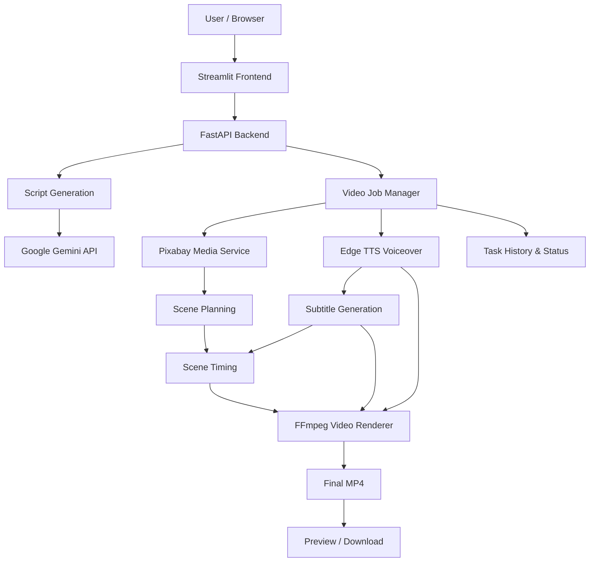

# 🎬 Macy AI
### Intelligent Multilingual Video Creation Studio

**Transform ideas into narrated videos with artificial intelligence.**

[](https://www.python.org/)
[](https://fastapi.tiangolo.com/)
[](https://streamlit.io/)
[](https://ai.google.dev/)
[](https://ffmpeg.org/)

**Macy AI** is a Python-based AI video-generation platform that converts a text topic or script into a narrated video using automated script generation, stock-footage retrieval, multilingual text-to-speech, synchronized subtitles, and FFmpeg video rendering.

The application combines a customized Streamlit interface with a FastAPI backend and a modular media-processing pipeline.

**Repository:** https://github.com/Akhilesh6007/Macyai.in

---

## Project Overview

Creating short-form videos manually involves multiple repetitive tasks: writing scripts, finding footage, recording narration, creating subtitles, editing scenes, and exporting the final video.

Macy AI aims to simplify this workflow through automation.

Users can provide a topic, generate or edit a script, collect relevant stock videos, generate narration, and create a downloadable MP4 video.

### Key Objectives

- Automate the text-to-video creation workflow.
- Support English and Hindi narration.
- Reduce manual video-editing effort.
- Match stock footage to narration topics.
- Generate subtitles using speech timing data.
- Manage background video-generation jobs.
- Provide a simple interface for generating, previewing, and downloading videos.

---

## Features

### AI Script Generation

- Generate video scripts from user-provided topics.
- Generate relevant stock-footage search keywords.
- Integrate Google Gemini through an OpenAI-compatible API.
- Allow users to review and edit generated scripts.
- Support manual scripts when AI generation is unavailable.

### Stock Footage Retrieval

- Search Pixabay for videos matching generated keywords.
- Download stock footage for rendering.
- Organize media assets within individual video tasks.
- Handle unavailable search results and download failures.

### Multilingual Voiceover

- Generate narration using Edge TTS.
- Support English and Hindi scripts.
- Automatically select a voice based on script language.
- Split longer text into manageable speech segments.
- Store timing metadata for subtitle generation.

### Automatic Subtitles

- Generate SRT subtitles from speech timing metadata.
- Synchronize captions with narration.
- Support English and Hindi text.
- Integrate subtitles into video rendering.

### Scene Planning and Timing

- Divide scripts into narration sections.
- Match scenes to downloaded footage using keyword overlap.
- Generate structured scene plans.
- Derive approximate scene boundaries from subtitle timestamps.
- Render timed scenes using FFmpeg.

The current scene-matching approach uses keyword-based matching and subtitle-derived timing. It is not a custom-trained visual understanding model.

### Video Generation

- Render stock footage into MP4 videos.
- Combine footage, narration, and subtitles.
- Support portrait-oriented video output.
- Trim or repeat clips to fit narration duration.
- Track rendering progress and errors.

### Task Management

- Submit video-generation tasks through REST APIs.
- Track queued, processing, completed, and failed jobs.
- Store task metadata and generated outputs.
- View task history.
- Preview and download completed videos.

---

## Technology Stack

| Layer | Technology | Responsibility |
|---|---|---|
| Frontend | Streamlit | Interactive video-creation interface |
| Backend | FastAPI | REST APIs and request handling |
| Programming language | Python | Business logic and orchestration |
| Generative AI | Google Gemini API | Script and keyword generation |
| Stock footage | Pixabay API | Media search and downloads |
| Text-to-speech | Edge TTS | English and Hindi narration |
| Video processing | FFmpeg | Video encoding and media composition |
| Subtitles | SRT | Timed captions |
| Background processing | FastAPI BackgroundTasks | Local asynchronous job execution |
| Persistence | JSON and local filesystem | Task metadata and outputs |
| Version control | Git and GitHub | Source-code management |

---

## System Architecture



### Video-Generation Workflow

1. **User input:** Enter a topic or provide a script.
2. **AI processing:** Generate the narration script and search keywords.
3. **Media retrieval:** Search for and download relevant Pixabay clips.
4. **Voice generation:** Convert narration text into speech.
5. **Subtitle generation:** Generate SRT captions from speech timings.
6. **Scene planning:** Arrange selected footage into narrative scenes.
7. **Video rendering:** Use FFmpeg to combine footage, voiceover, and subtitles.
8. **Output:** Preview or download the rendered MP4.

---

## Project Structure

The main application components are organized as follows:

```text
Ai_video/
│
├── app/
│   ├── controllers/
│   │   └── v1/
│   │       ├── ai_scripts.py
│   │       └── video_tasks.py
│   │
│   ├── services/
│   │   ├── llm.py
│   │   ├── material.py
│   │   ├── voice.py
│   │   ├── subtitle.py
│   │   ├── scenes.py
│   │   ├── scene_timing.py
│   │   ├── video.py
│   │   ├── timed_video.py
│   │   └── video_jobs.py
│   │
│   └── asgi.py
│
├── webui/
│   ├── components/
│   │   ├── video_job_client.py
│   │   └── task_manager.py
│   └── Main.py
│
├── test/
│   └── ...
│
├── docs/
├── resource/
├── storage/                  # Local generated data; excluded from Git
├── requirements.txt
├── pyproject.toml
├── .gitignore
└── README.md
```

The exact structure may evolve as additional features are implemented.

---

## Installation and Setup

### Prerequisites

Before starting, install:

- Python 3.11 (recommended)
- Git
- FFmpeg or a supported FFmpeg binary provided through the Python environment
- An internet connection for Gemini, Pixabay, and Edge TTS
- A valid Google Gemini API key
- A valid Pixabay API key

### 1. Clone the Repository

```bash
git clone https://github.com/Akhilesh6007/Macyai.in.git
cd Macyai.in
```

### 2. Create a Virtual Environment

On Windows PowerShell:

```powershell
py -3.11 -m venv .venv
```

Activate it:

```powershell
.\.venv\Scripts\Activate.ps1
```

If PowerShell activation is restricted, you can call the virtual environment's Python executable directly without activation.

### 3. Install Dependencies

```powershell
.\.venv\Scripts\python.exe -m pip install --upgrade pip
.\.venv\Scripts\python.exe -m pip install -r requirements.txt
```

Check dependency health:

```powershell
.\.venv\Scripts\python.exe -m pip check
```

### 4. Configure Environment Variables

Create a `.env` file in the project root.

Example Gemini configuration:

```dotenv
MACY_LLM_API_KEY=YOUR_GEMINI_API_KEY
MACY_LLM_MODEL=gemini-2.5-flash
MACY_LLM_BASE_URL=https://generativelanguage.googleapis.com/v1beta/openai/
```

Configure the Pixabay API credential using the environment-variable name required by `app/services/material.py`.

**Important:** The model shown above is an example. Select a model available to your account and current API quota.

Never commit `.env` or actual API credentials to GitHub.

### 5. Start the Backend

Open a terminal in the project root:

```powershell
.\.venv\Scripts\python.exe -m uvicorn app.asgi:app --host 127.0.0.1 --port 8081
```

Backend:

http://127.0.0.1:8081

API documentation:

http://127.0.0.1:8081/docs

### 6. Start the Frontend

Open a second terminal:

```powershell
.\.venv\Scripts\python.exe -m streamlit run webui/Main.py --server.port 8501
```

Open:

http://localhost:8501

The Macy AI interface should now be accessible in your browser.

---

## How to Use Macy AI

### Example: Generate an AI Technology Video

**Video topic:**

> How Artificial Intelligence and Robots Will Change Our Future

**Example keywords:**

```text
humanoid robot,
artificial intelligence laboratory,
robotic automation,
future technology,
smart city
```

**Recommended settings:**

| Setting | Example |
|---|---|
| Language | English |
| Video source | Pixabay |
| Video format | Portrait 9:16 |
| Voiceover | Automatic |
| Subtitles | Enabled |
| Number of videos | 1 |

**Steps:**

1. Open the Macy AI frontend.
2. Enter your video topic.
3. Generate a script and keywords using Gemini, or enter them manually.
4. Review the script and footage keywords.
5. Select supported video, audio, and subtitle settings.
6. Click **Generate Video**.
7. Track the job through **Video Generation Status**.
8. Open the Task Manager to preview or download the final video.

### Hindi Video Example

**Topic:** सफलता पाने के लिए 5 जरूरी आदतें

**Footage keywords:**

```text
student studying,
morning routine,
hard work,
goal setting,
success motivation
```

For manual Hindi narration, provide the script predominantly in Devanagari so automatic voice selection can identify Hindi correctly.

---

## REST API Overview

The FastAPI backend provides endpoints for script generation and video-task management.

| Method | Endpoint | Description |
|---|---|---|
| GET | `/health` | Backend health status |
| POST | `/api/v1/scripts/demo` | Offline/demo script generation |
| POST | `/api/v1/scripts/generate` | AI-based script generation |
| POST | `/api/v1/tasks/generate` | Submit video-generation job |
| GET | `/api/v1/tasks` | List video-generation tasks |
| GET | `/api/v1/tasks/{task_id}` | Retrieve task status |
| GET | `/api/v1/tasks/{task_id}/preview` | Preview generated video |
| GET | `/api/v1/tasks/{task_id}/download` | Download generated video |

The live OpenAPI schema at `/docs` is the authoritative reference for available routes, request bodies, and response formats.

### Example: Check Backend Health

```powershell
Invoke-RestMethod http://127.0.0.1:8081/health
```

Expected response for a healthy backend:

```json
{
  "status": "ok"
}
```

### Example: Submit a Video Task

```json
{
  "subject": "Future of Artificial Intelligence",
  "script": "Artificial intelligence is changing how we live and work...",
  "keywords": [
    "artificial intelligence",
    "robotics laboratory",
    "future technology"
  ]
}
```

Submit this payload to:

```text
POST /api/v1/tasks/generate
```

The task response provides an identifier that can be used to retrieve its status.

---

## Testing

Macy AI includes development tests for different stages of the video-generation pipeline.

Representative tests include:

| Test Script | Purpose |
|---|---|
| `test/check_ai_api.py` | AI API configuration |
| `test/check_gemini.py` | Gemini connectivity |
| `test/check_pixabay.py` | Pixabay media search |
| `test/check_pixabay_download.py` | Footage downloading |
| `test/check_voice.py` | Voiceover generation |
| `test/check_subtitles.py` | Subtitle generation |
| `test/check_video_render.py` | Video rendering |
| `test/check_scene_plan.py` | Scene planning |
| `test/check_scene_timing.py` | Scene timestamp validation |
| `test/check_timed_video.py` | Timed rendering |

### Run an Offline Scene Test

```powershell
.\.venv\Scripts\python.exe test/check_scene_plan.py
```

### Run Scene Timing Validation

```powershell
.\.venv\Scripts\python.exe test/check_scene_timing.py
```

Some tests require previously generated local task data, while others access external services.

Always review a test's prerequisites before executing it.

### End-to-End Validation

A successful final test should confirm:

- The backend starts successfully.
- Script and keyword generation work.
- Footage can be retrieved.
- Narration is generated.
- Subtitles are synchronized.
- Scenes are rendered correctly.
- The task reaches the completed state.
- The MP4 file can be previewed and downloaded.

---

## Engineering Challenges

### Reliable Media Processing

Different stock videos can have different resolutions, frame rates, durations, and aspect ratios.

The FFmpeg pipeline normalizes these properties to produce a consistent output.

### Narration and Subtitle Synchronization

Speech generation produces timing metadata that is converted into SRT subtitle cues.

Scene-timing logic uses subtitle boundaries to estimate when video footage should change.

### Long-Text Voice Generation

Long narration is divided into smaller chunks to improve compatibility with the speech-generation service.

### Background Task Tracking

Video generation can take longer than a typical HTTP request.

FastAPI background tasks allow the application to submit work and inspect progress through separate endpoints.

### Error Handling

The pipeline must handle external API failures, media-download issues, text-to-speech problems, and FFmpeg rendering errors without losing useful diagnostic information.

---

## Current Limitations

Macy AI is currently developed as a local-first video creation application.

Known architectural limitations and considerations include:

- AI generation depends on provider availability and quota.
- Pixabay footage depends on available search results and license terms.
- Edge TTS requires access to its speech service.
- Scene matching is primarily keyword-based.
- Scene timestamps are estimated from subtitle timings.
- Local JSON persistence is not a substitute for a production multi-user database.
- FastAPI in-process background tasks are not a durable distributed job queue.
- Video rendering speed depends on available hardware and output settings.

The current GitHub repository hosts source code; it is not itself a deployed video-generation service.

---

## Future Roadmap

The following features are planned or subject to further implementation and testing:

- [ ] AI-assisted storyboard generation
- [ ] Semantic footage ranking
- [ ] Interactive scene editor
- [ ] Individual scene replacement and re-rendering
- [ ] Background music with automatic voice ducking
- [ ] Additional subtitle animations and templates
- [ ] Advanced video transitions
- [ ] Multiple export aspect ratios and presets
- [ ] Durable job queue and improved retry handling
- [ ] Automated regression test suite
- [ ] Docker packaging
- [ ] Production-oriented deployment
- [ ] Performance monitoring and benchmarking

Features should be marked complete only after they are implemented and verified.

---

## Security and Responsible Usage

- Store API credentials in environment variables rather than source code.
- Do not upload `.env` files or secret keys to GitHub.
- Exclude local task data, generated videos, and temporary media from commits.
- Respect stock footage license conditions.
- Use background music and additional assets only when appropriately licensed.
- Verify factual claims in AI-generated scripts before publishing videos.
- Review generated output for visual or narration errors before distribution.

---

## Project Demonstration

For a technical or placement demonstration, the recommended workflow is:

1. Explain the problem Macy AI solves.
2. Show the Streamlit video-generation interface.
3. Generate a script or demonstrate a saved script.
4. Explain Gemini and Pixabay integration.
5. Show multilingual narration and subtitles.
6. Demonstrate scene planning and FFmpeg rendering.
7. Open the Task Manager.
8. Preview and download a completed MP4.
9. Explain implementation challenges and engineering tradeoffs.

A short demonstration video and application screenshots can be added to the repository once prepared.

---

## Author

**Akhilesh Kumar**

GitHub: [@Akhilesh6007](https://github.com/Akhilesh6007)

Project repository: [Macyai.in](https://github.com/Akhilesh6007/Macyai.in)

---

## Project Status

**Macy AI is under active development.**

The core video-generation workflow has been implemented and exercised locally. Additional features, automated verification, documentation, and deployment improvements are ongoing.

If you find a bug or have a suggestion, please open an issue in the GitHub repository.

---

**Macy AI — From Text to Video, Powered by AI.**
