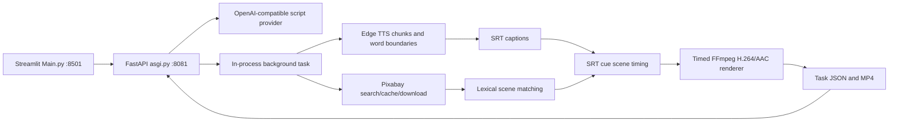

# Architecture

`video_jobs.py` owns orchestration and stage metrics. `material.py` caches search results and downloaded clips. `voice.py` merges decoded narration chunks and shifts word offsets using decoded sample counts. `subtitle.py` groups words into SRT cues. `scenes.py` splits narration and ranks available footage by keyword overlap, with stable search-order tie breaking. `scene_timing.py` assigns continuous ranges at weighted SRT cue boundaries. This is a heuristic, not forced alignment or learned visual understanding.

`timed_video.py` converts cumulative timestamps to frame boundaries, loops/trims input clips, normalizes dimensions and FPS, concatenates scenes, burns captions and muxes narration. The final scene extends to measured audio duration. `video.py` remains the legacy renderer; the current job pipeline does not automatically fall back to it.

Each task has manifest.json, task.json, narration/timings, SRT, scene plans and final MP4. Status replacement uses a temporary JSON file; concurrent job execution is not locked. Completed tasks are protected against rerunning through the job service. New exports must use new tasks/paths. FastAPI BackgroundTasks provides no durable queue or restart recovery; bounded single-worker execution should precede production scaling. No Redis/Celery is needed to demonstrate the present local architecture.
